# moe-gpt2

A small research playground for **Mixture-of-Experts language models** trained on WikiText-2 with the GPT-2 tokenizer.
It compares two **expert architectures** (a hand-written causal Transformer and a Hugging Face GPT-2 stack) under two
**routing strategies** (a learned router and a vocabulary-guided router), with resumable training, structured logs and
expert-usage plots.

> **Status (2026-10-16):** [Experiment 2](#experiment-2-67m-parameters-full-training-split) uses 6.7M parameters
> and the full training split, and reaches test PPL **459.6** (`transformer-learned`). Frequency-band guidance
> (`freq`) beats id-range guidance for both architectures. Results from before the overhaul came from code with
> routing and attention bugs (see [Changelog](#changelog)) and were discarded.

---

## Contents

- [Architecture](#architecture)
- [Data](#data)
- [Routing strategies](#routing-strategies)
- [Losses](#losses)
- [Project layout](#project-layout)
- [Setup](#setup)
- [Usage](#usage)
- [Configuration](#configuration)
- [Outputs and logs](#outputs-and-logs)
- [Results](#results)
- [Extending](#extending)
- [Roadmap](#roadmap)
- [Changelog](#changelog)

---

## Architecture

Every model is a `MixtureOfExpertsLM`. It has a shared token embedding and *E* experts that each process the full
sequence. A router mixes the experts **per position**, and a linear head produces vocabulary logits.

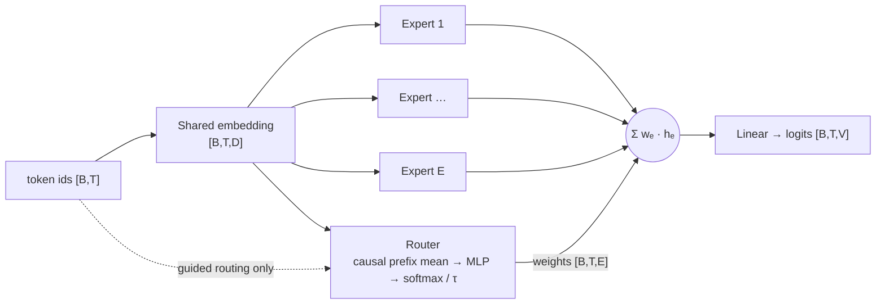

| Expert | Implementation | Positions | Attention |
|---|---|---|---|
| `transformer` | `NUM_LAYERS` post-LN blocks built on `nn.MultiheadAttention` | learned, per expert | causal mask |
| `gpt2` | Hugging Face `GPT2Model` fed with `inputs_embeds` | GPT-2 `wpe`, per expert | causal (built in) |

**Causality.** Every component only sees tokens at or before the current position. Attention is masked, and the
router works on a *running* (prefix) mean of the embeddings, so training and generation behave the same way.

## Data

WikiText-2 (raw), tokenized with the GPT-2 BPE tokenizer.

1. **Clean:** WikiText's tokenized spacing is undone: `role @-@ playing` becomes `role-playing`, `1 @,@ 000`
   becomes `1,000`, and `game 's` becomes `game's`. The spaces before punctuation are removed, and section headers
   are dropped.
2. **Stream:** each article's paragraphs are joined with newlines, and every article ends with an EOS token. Each
   split becomes one token stream, so nothing is thrown away.
3. **Window:** training uses 128-token windows every `STRIDE` tokens. Validation and test use stride 127, so every
   token is predicted exactly once.
4. **Cache:** the tokenized splits are saved to `cache/`. After the first run, loading takes about 0.1 s.

| Split | Tokens | Articles | Windows (default config) |
|---|---|---|---|
| train | 2,248,681 | 629 | 7,024 (first 10%, stride 32) |
| validation | 232,423 | 60 | 1,830 |
| test | 266,053 | 62 | 2,094 |

`DATA_FRACTION` only shrinks the training stream. Validation and test always use the full split, so metrics are
comparable between runs.

## Routing strategies

| Strategy | Class | Mixing weights | Auxiliary loss |
|---|---|---|---|
| `learned` | `LearnedRouter` | `softmax(MLP(prefix_mean) / τ)`, τ = 2.0 | **balance**: MSE between mean expert usage and uniform |
| `guided` | `PartitionGuidedRouter` + id ranges | `0.6 · learned + 0.4 · onehot(expert assigned to the current token)`, τ = 1.2 | **routing**: NLL of the assigned expert under the learned router |
| `freq` | `PartitionGuidedRouter` + frequency bands | same as `guided` | same as `guided` |

Both guided strategies fix a token→expert partition in advance, in the spirit of *Hash Layers* (Roller et al.,
2021). They differ only in the partition:

- **`guided`** splits the vocabulary into *E* contiguous **id ranges**. Low BPE ids are frequent tokens, so the
  split is heavily skewed: with 2 experts, about 94% of running text belongs to expert 0.
- **`freq`** sorts tokens by training frequency and cuts them into *E* bands that each carry an **equal share of
  the training tokens**. With 2 experts, expert 0 gets the 258 most frequent tokens (` the`, `,`, `.`, ` of`, …),
  roughly a function-word expert, and expert 1 gets the other 49,999. This partition is computed from the data, so
  it is stored in the checkpoint.

The plots report each expert's **affinity**: its average routing share on the tokens assigned to it. Guided models
are measured against their own partition, and learned models against the id ranges.

## Losses

```
total = TASK_LOSS_WEIGHT · cross_entropy  +  diversity  +  (balance | routing)
```

| Term | Weight (`config.py`) | Purpose |
|---|---|---|
| Cross-entropy | `TASK_LOSS_WEIGHT` = 0.8 | next-token prediction (reported unweighted as `train ce` / `val ce`) |
| Diversity | `DIVERSITY_LOSS_WEIGHT` = 0.1 | mean \|cosine similarity\| between expert outputs, to keep experts different |
| Balance | `BALANCE_LOSS_WEIGHT` = 0.1 | learned router: avoid collapsing onto one expert |
| Routing | `ROUTING_LOSS_WEIGHT` = 0.1 | guided router: agree with the vocabulary partition |

## Project layout

```
moe-gpt2/
├── train.py            CLI: train → test → sample, for one architecture and its routing strategies
├── infer.py            CLI: generate text from a trained run (single prompt or interactive)
├── config.py           every hyper-parameter in one place
├── data.py             WikiText-2 cleaning, token stream, cache and windowed DataLoaders
├── trainer.py          training loop, evaluation, resumable checkpoints, seeding
├── generation.py       sampling, best-checkpoint previews and end-of-training samples
├── plotting.py         expert-usage figure (utilisation, distribution, token heatmap, affinity)
├── log_utils.py        console + file logger, banners and aligned tables
├── report.py           README material from finished runs: curves, expert plots, tables, samples
├── models/
│   ├── __init__.py     registries (EXPERTS, ROUTERS) and build_model()
│   ├── base.py         interfaces: Expert, Router, Routing
│   ├── experts.py      TransformerExpert, GPT2Expert
│   ├── routers.py      LearnedRouter, PartitionGuidedRouter, id-range and frequency partitions
│   └── moe.py          MixtureOfExpertsLM and the diversity loss
├── docs/               figures and tables used in this README (written by report.py)
├── .vscode/launch.json run, resume and inference configurations
└── requirements.txt
```

## Setup

Tested with Python 3.10, PyTorch 2.5.1 and CUDA 11.8 in the `gpt2` conda env.

```bash
conda activate gpt2                       # C:\Users\Precision\anaconda3\envs\gpt2
pip install -r requirements.txt --extra-index-url https://download.pytorch.org/whl/cu118
```

WikiText-2 and the GPT-2 tokenizer are downloaded by Hugging Face on first use. Tokenized splits are cached in `cache/`.

## Usage

### Train

```bash
python train.py --arch transformer                   # both routing strategies, one after the other
python train.py --arch gpt2 --routing freq           # a single strategy
```

### Resume

Each epoch writes a full checkpoint containing the model, optimizer, RNG states and history. An interrupted run
continues where it stopped. A model that already finished is reloaded and tested, but not retrained.

```bash
python train.py --arch transformer --resume latest                         # newest transformer run
python train.py --arch gpt2 --resume runs/gpt2_20261015_120000             # a specific run
```

The learning-rate schedule is a closed-form cosine, so resuming with a different `EPOCHS` stays on schedule. Any
setting that changed since the run started is logged as a warning.

**Early stopping:** a model stops after `PATIENCE` epochs without a new best validation CE. The check uses the saved
history, so resuming an early-stopped model does not train it further.

### Inference

```bash
python infer.py --prompt "The history of artificial intelligence"           # newest run, first model
python infer.py --run runs/gpt2_20261015_120000 --model gpt2-guided         # interactive prompt loop
python infer.py --prompt "In recent scientific discoveries," --temperature 1.0 --max-new-tokens 80
```

`infer.py` restores the run's saved `settings.json` before it builds the model, so a checkpoint still loads after
`config.py` has changed.

### VS Code

`.vscode/launch.json` provides **Train**, **Resume** (prompts for a run folder; default `latest`) and
**Inference · interactive** (pick the run and model), all using the `gpt2` env interpreter.

## Configuration

All settings live in [config.py](config.py) and are saved with every run.

| Group | Setting | Default |
|---|---|---|
| Data | `CONTEXT_LENGTH`, `STRIDE` (train), `DATA_FRACTION` (train), `DATA_CACHE_DIR` | 128, 64, 1.0, `cache` |
| Model | `NUM_EXPERTS`, `HIDDEN_DIM`, `NUM_HEADS`, `NUM_LAYERS`, `DROPOUT` | 2, 64, 4, 2, 0.3 |
| Routing | `LEARNED_ROUTE_TEMPERATURE`, `GUIDED_ROUTE_TEMPERATURE`, `GUIDED_LEARNED_SHARE` | 2.0, 1.2, 0.6 |
| Training | `EPOCHS`, `PATIENCE`, `BATCH_SIZE`, `LEARNING_RATE`, `WEIGHT_DECAY`, `GRAD_CLIP` | 10, 3, 16, 6e-4, 0.01, 0.5 |
| Output | `PLOT_EVERY`, `RUNS_DIR`, `SEED` | 5, `runs`, 42 |

## Outputs and logs

Each run gets its own folder:

```
runs/transformer_20261015_120000/
├── train.log                         full console log (appended on resume)
├── settings.json                     CLI arguments + config values
├── results.json                      final comparison table
├── transformer-learned.pth           best weights (by validation CE)
├── transformer-learned_last.pth      resumable checkpoint
├── transformer-learned_history.json  per-epoch metrics
├── transformer-learned_samples.json  end-of-training samples {prompt: {temperature: text}}
└── plots/
    ├── training_curves.png           train/val CE of every model in the run
    ├── transformer-learned_best.png  expert usage of the best checkpoint
    └── transformer-learned_epoch001.png …
```

Logs are tables, one row per epoch. ★ marks a new best checkpoint, and a short sample is printed after it.
This excerpt is from the `gpt2-guided` run:

```
01:16:25 │   epoch │       lr │ train ce │ diversity │   routing │  val ce │   val ppl │     usage │  affinity │   tok/s │  time │
01:16:25 │ ────────┼──────────┼──────────┼───────────┼───────────┼─────────┼───────────┼───────────┼───────────┼─────────┼───────┼──
01:16:25 │    1/20 │ 6.00e-04 │   9.5848 │    0.0796 │    0.0515 │  8.1748 │    3550.5 │ 0.91/0.09 │ 0.93/0.47 │   27.9k │   36s │ ★
01:16:25 │     ✎ The history of artificial intelligence ⟶ multi a figure Chak prominent valueAR be work review, born history …
01:17:00 │    2/20 │ 5.96e-04 │   7.5075 │    0.0399 │    0.0270 │  7.8548 │    2578.0 │           │           │   27.9k │   35s │ ★
01:17:35 │    3/20 │ 5.85e-04 │   7.3883 │    0.0029 │    0.0265 │  7.8425 │    2546.6 │           │           │   27.8k │   35s │ ★
01:18:11 │    4/20 │ 5.67e-04 │   7.3042 │    0.0026 │    0.0259 │  7.7885 │    2412.8 │           │           │   27.8k │   35s │ ★
```

On an otherwise idle Quadro RTX 5000, an epoch takes about 35 s, or about 28k tokens/s. The first epoch of a run also
pays for CUDA and DataLoader worker start-up.

Each plot has four panels: mean routing weight per expert, the per-sequence routing distribution, the routing share
of the 30 most frequent tokens, and the affinity to each expert's assigned vocabulary range.

## Results

Two experiments so far. Each model was trained once with seed 42, so differences of about 1% are within noise.

| | Experiment 2 (current defaults) | Experiment 1 |
|---|---|---|
| `HIDDEN_DIM` / heads / layers | 64 / 4 / 2 | 8 / 2 / 2 |
| Parameters | 6.7M | 0.86M |
| Training data | full train split, 2.25M tokens, stride 64 | first 10%, 225k tokens, stride 32 |
| Epochs | 10 (`PATIENCE` = 3) | 20 |
| Routing strategies | `learned`, `guided`, `freq` | `learned`, `guided` |
| Best test PPL | **459.6** (`transformer-learned`) | 2137.6 (`gpt2-learned`) |

### Experiment 2: 6.7M parameters, full training split

| Model | Params | Best epoch | Best val CE | Test CE | Test PPL | Usage (E0/E1) | Affinity (E0/E1) |
|---|---:|---:|---:|---:|---:|---:|---:|
| `transformer-learned` | 6,703,763 | 10 | **6.1184** | **6.1303** | **459.6** | 0.50/0.50 | 0.50/0.50 |
| `transformer-guided` | 6,703,763 | 9 | 6.1908 | 6.1942 | 489.9 | 0.93/0.07 | 0.95/0.45 |
| `transformer-freq` | 6,703,763 | 10 | 6.1445 | 6.1444 | 466.1 | 0.51/0.49 | 0.71/0.69 |
| `gpt2-learned` | 6,704,147 | 10 | 6.1900 | 6.1985 | 492.0 | 0.50/0.50 | 0.50/0.50 |
| `gpt2-guided` | 6,704,147 | 10 | 6.2103 | 6.2190 | 502.2 | 0.92/0.08 | 0.95/0.45 |
| `gpt2-freq` | 6,704,147 | 10 | 6.1768 | 6.1852 | 485.5 | 0.54/0.46 | 0.74/0.67 |

Usage and affinity are measured on the best checkpoint. For learned routers, affinity is measured against the id
ranges.

#### Findings

1. **Scale matters most.** With 8× the width and 10× the data, test perplexity falls from about 2,140 to about
   460–500. That is a 4–5× improvement, far larger than any routing effect.
2. **The architecture ranking flipped.** At this size the hand-written Transformer expert beats GPT-2: 459.6 vs.
   492.0 with learned routing. In Experiment 1, at width 8, GPT-2 was ahead. This is a single seed, so treat the
   gap as indicative only.
3. **Frequency bands are the better guidance signal.** `freq` beats id-range `guided` for both architectures, by
   4.9% for the transformer and 3.3% for GPT-2, and it keeps both experts in balanced use (about 50/50 instead of
   93/7). For GPT-2, `freq` is the best strategy overall, 1.3% ahead of `learned`. For the transformer, `learned`
   is still ahead, by 1.4%.
4. **The learned routers settle near an even blend.** Mean usage is exactly 0.50/0.50. Expert 0's per-position
   weight still varies (std 0.013 for the transformer, 0.045 for GPT-2; range about 0.21–0.69), but the model mostly
   behaves like an evenly weighted ensemble of two experts.
5. **The router can't follow per-token guidance.** In `freq` models, every frequent token gets the same 0.71 / 0.29
   split, and 0.71 ≈ 0.6 · 0.5 + 0.4 · 1. In other words, the learned part stays near 0.5, and all token
   specificity comes from the fixed one-hot term. The router sees a *prefix mean* of embeddings, which barely
   changes from one token to the next, so it cannot pick out the current token. Routing on the current token's own
   hidden state is the natural next step (see [Roadmap](#roadmap)).
6. **The models are undertrained, not overfitting.** Five of six models hit their best validation CE at the last
   epoch, and early stopping never fired. More epochs would still help.
7. **Samples are now locally grammatical.** Clauses such as "The ship was the southern peninsula, but suffered…" have
   correct syntax, and the subject matter matches WikiText (ships, storms, battles, sport). There is no long-range
   coherence yet.

#### Training curves

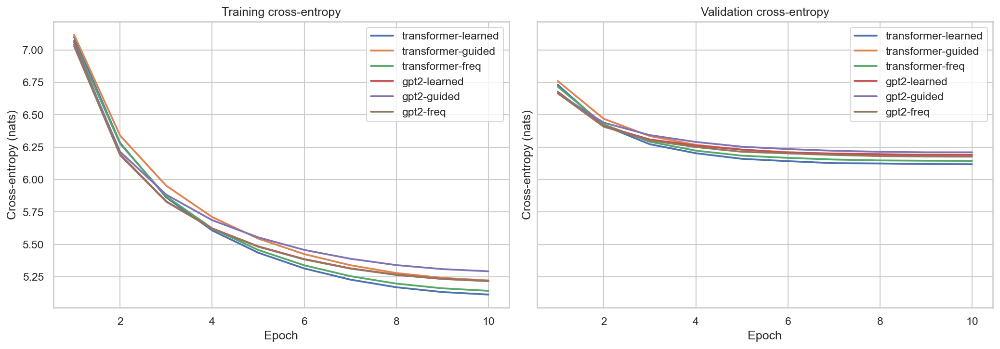

#### Expert usage (best checkpoint, transformer experts)

| Learned | Id-range guided | Frequency guided |
|---|---|---|
| 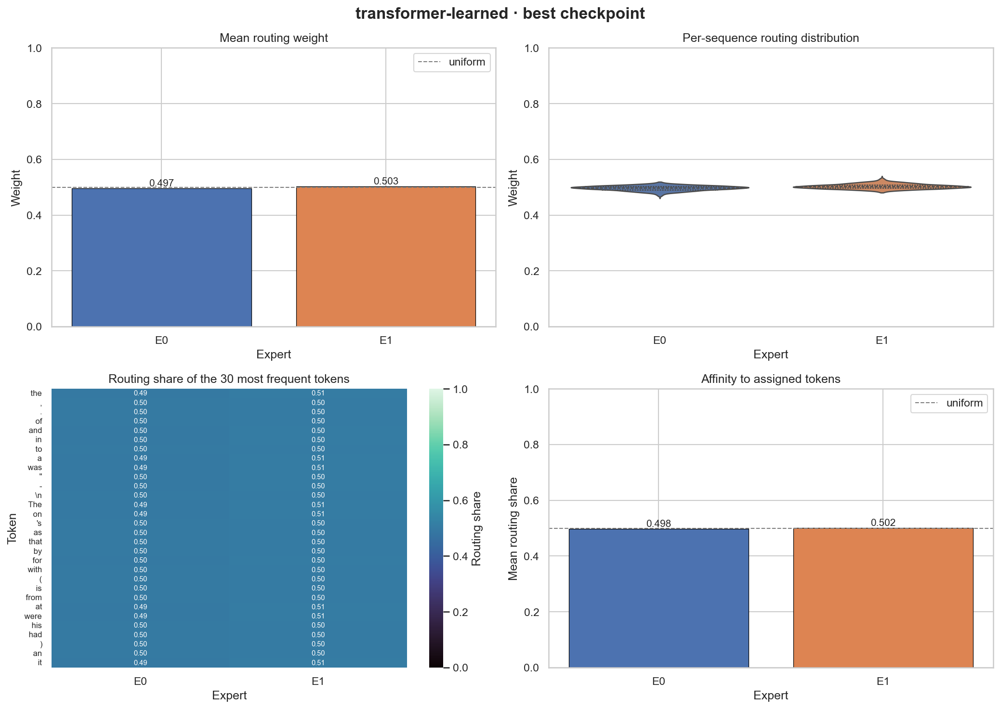 | 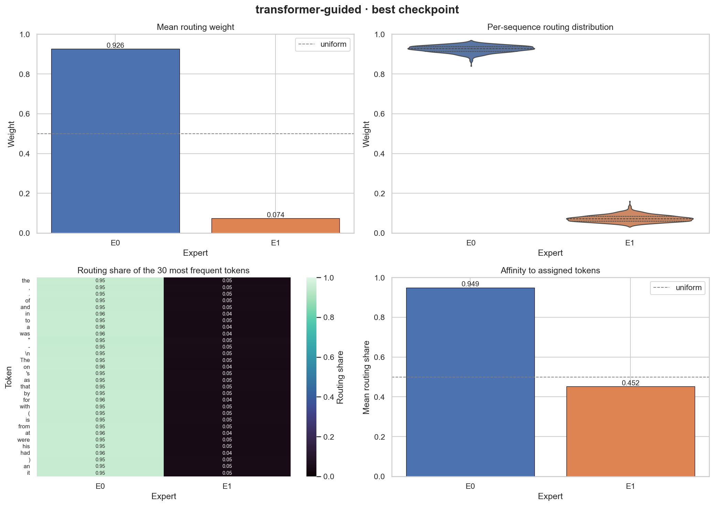 | 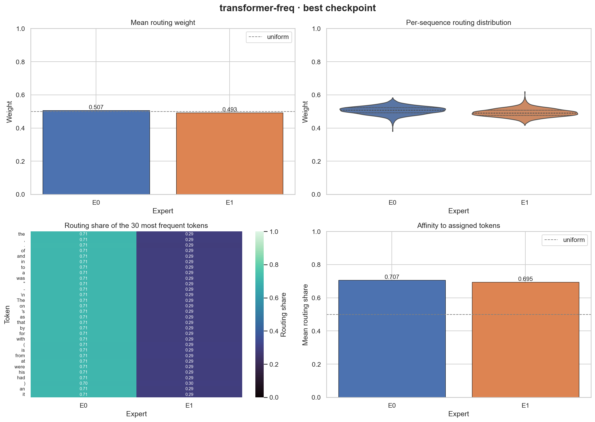 |

<details>
<summary>GPT-2 experts</summary>

| Learned | Id-range guided | Frequency guided |
|---|---|---|
| 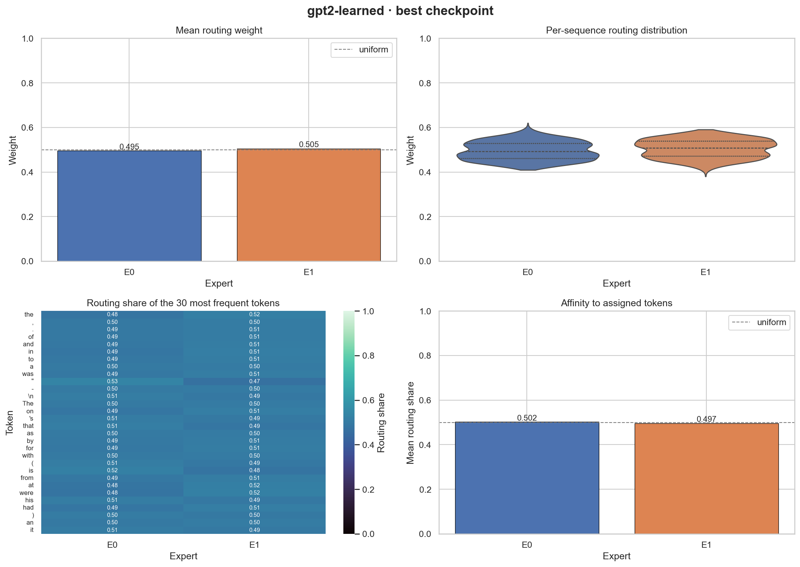 |  | 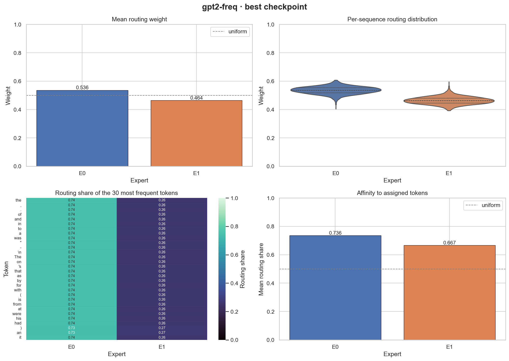 |

</details>

#### Samples side by side

All six models continue the same prompts with the same seed at temperature 0.7, using their best checkpoints. The
output is truncated to 40 words.

**The history of artificial intelligence** …

| Model | Continuation (T = 0.7) |
|---|---|
| `transformer-learned` | , the state of the flow between the town. Most of the 2nd Maritime Dakota were the region and was built at the coast of the day. The ship was the southern peninsula, but suffered the remnants of the Antonraia. … |
| `transformer-guided` | , and the wisdom of the General house. The changes of the British Isles. This behaviour with the earlier individuals and power in motorography and whose gates. The Song is also constructed on the island of the city, which is … |
| `transformer-freq` | , and the main deity had been built. The military part of the United States were the largest island. The problems of the ships were planned to the capital and the soldiers, the Chinese authorities were constructed with the incursion. … |
| `gpt2-learned` | and the majority of Rio de Janeiro bid committee, the FIA were successful in the Irish rugby World War. In the second, the 1990s, the storm caused the second tropical storm of the peak intensity of Verical cyclones, the storm … |
| `gpt2-guided` | of the majority of Rio de Janeiro bid committee, the Assembly were successful in the Irish rugby union. Disraeli was also accused the original synagogue's second season, the second best level of the scene, and was constructed in the US … |
| `gpt2-freq` | of the majority of Rio de Janeiro bid committee, the Assembly were successful, and Irish rugby union. Disasters were also referred to have been the company, and were built in the portal of the scene, and to the United States. … |

**In recent scientific discoveries,** …

| Model | Continuation (T = 0.7) |
|---|---|
| `transformer-learned` | and his father's Office, Pitman was a " and " an episode of a girl ". It was a " Patty Cake " of the " and Carey, and 't You'll 't get back to the best-pack a record of … |
| `transformer-guided` | which had " Axe ", the album, to the song's lyrics. " My Boo " was to hit the Recording Industry & B Performance on all the album chart. It ranked one of Dylan's on the song in the charts, … |
| `transformer-freq` | and his father's Office, he was born with him as " an heir of a girl ". John Gielniel, two of His father, he was born based at the first time distortions and family. In the same year, she was … |
| `gpt2-learned` | the commercial Prime Minister of the main objective. The Guardian and that the civil rights of the Civil War III of the use of a large numbers of the government's work was not recorded the Lords of the crusaders. The … |
| `gpt2-guided` | the commercial Prime Minister of the main work. The Guardian said that " a balance and " and a " [the-up a " big " of the " so we become a " if you I don 't see we … |
| `gpt2-freq` | and six days, who had marked the British battle, and the team was not in the Second Division. On 7, Hamels pitched to match and Avtronge Mark Barron: Prime Minister of the two weeks. The victory over the season |

**The most important aspect of learning is** …

| Model | Continuation (T = 0.7) |
|---|---|
| `transformer-learned` | the rocks of the soil of the Latin language of the Ganges. It is considered the most common version of the modern Master of the kakapo. J. The fungus include the Hebrew small species is used in the genus Missouri … |
| `transformer-guided` | often used to be the word that is a model at the underside of the Earth. The precise nature of ancientgernacle poet is the primary dwarf of the church, and is used to a " Phifiter is related to the … |
| `transformer-freq` | the rocks of the soil of the Americas. The bay is a stable achievement. The west of the species, calciumosaurus of the kakapo. J. The wood is a number of the most important legs from the east of the 15 |
| `gpt2-learned` | the mangroscopic, when the family of a starling and a series of the Triatomyclic or the book. The spirit of the first-tjenung is a " The star is named in the novel, the second |
| `gpt2-guided` | the Coldrum Stones, in the longest immigration to a starling depicting a series of the Triatomyclicca, often used locally by the principle of the krekuedocarbon viruses, the starling. It is possible, the second |
| `gpt2-freq` | such as because of the master of the Iguan and the earliest known. " The eaves " In 1894, Scientology is the early 1970s in the island of the 2005, the film features the film, in the song, released in |

<details>
<summary>More prompts</summary>

**The future of technology lies in** …

| Model | Continuation (T = 0.7) |
|---|---|
| `transformer-learned` | the mid freeway, particularly the 2005. The island also recognized the city of Clan, and the hurricane of the Atlantic Ocean. The city government, within the New Zealand Stastonše, which was the storm of a storm. The pattern was |
| `transformer-guided` | the Roman Catholic Church of the Royal Navy. In 1940s, the commander of the adjacent to the Kritra and the Congo. A second member of the Roman Catholic Union, the first Sultan Confederacy, which she was made, the attacking of … |
| `transformer-freq` | the mid-marks. Another forms of the cathedral class, and the site is based on the bank of the 18. The city of Old Pine Church of the region is the first church, which increases in a diet of the other … |
| `gpt2-learned` | the pistol, but also appeared on their client and two others, on the French fleet. In the court, the Europeans, the war on a state of the colony, the other artefacts did not tell of the army's francophone, a |
| `gpt2-guided` | the House of cricket and the Socialist or experiments and two others, on the French fleet used for England, so a pharaohs. The following year's atmosphere for the aforementioned of the majority of the Bible's earlier, but it was sent … |
| `gpt2-freq` | the bird difficult to be able to the main battery. The disease is the kakapo was the first probably the designation of the first light-Prince. The cap. This unique as a predatorls – Munsee and the two-shaped species |

**The great poet of Persia, Jallaludin Rumi once said, if the world brings you to your knees, you are in the** …

| Model | Continuation (T = 0.7) |
|---|---|
| `transformer-learned` | beginning of the true. Kicoceros of who ’ sized two best black-fund-fte. The story is scheduled. The Sun of Rihanna, and the film's eight film is said and the word " is " |
| `transformer-guided` | present, but it a smart, where they can be seen because you be I see it cannot be to be a " way " good. " The lyrics regarded the song is " controversy of the song to launch for … |
| `transformer-freq` | beginning of the true. Kale's works of the starlings, a two best black-fundal; the most of the Goat was also an evil and rate. He was in the late 1960s in the history, a child set telephone |
| `gpt2-learned` | case behind them, but the ball to do not have a " or the " We is not have a casual. " The poem is " The ruin. " The character of the paintings are " and has been collected … |
| `gpt2-guided` | case behind them, but the ball to do not have a " or we always want to the consent. " a " were doing so that " with the songs have another to see the game. " you know this … |
| `gpt2-freq` | same time. " he could think the zombie tells respect her out that the arrest, I got a lot of her lover, and that she gets him. " The more called " thoroughly's life, " The life to her " … |

</details>

### Experiment 1: 0.86M parameters, 10% of the training split

**Setup:** 20 epochs per model, seed 42, 2 experts, `HIDDEN_DIM` = 8, 2 layers per expert. Training uses the first
10% of the train stream (224,868 tokens, 7,024 windows at stride 32). Validation and test use the full splits. Each
model was trained once, with no repeat seeds, so differences of about 1% are within noise.

| Model | Params | Best epoch | Best val CE | Test CE | Test PPL | Final usage (E0/E1) | Final affinity (E0/E1) |
|---|---:|---:|---:|---:|---:|---:|---:|
| `transformer-learned` | 859,995 | 14 | 7.6705 | 7.7122 | 2235.5 | 0.33/0.67 | 0.33/0.67 |
| `transformer-guided` | 859,995 | 12 | 7.6934 | 7.7339 | 2284.4 | 0.94/0.06 | 0.96/0.44 |
| `gpt2-learned` | 860,043 | 10 | **7.6317** | **7.6675** | **2137.6** | 0.31/0.69 | 0.31/0.69 |
| `gpt2-guided` | 860,043 | 8 | 7.6586 | 7.6919 | 2190.5 | 0.94/0.06 | 0.97/0.43 |

#### Findings

1. **GPT-2 experts beat the hand-written Transformer.** Test perplexity is about 4% lower: 2138 vs. 2236 with
   learned routing, and 2191 vs. 2284 with guided routing. The GPT-2 blocks use pre-LN, GELU and a final LayerNorm,
   while the Transformer expert is a plain post-LN block with ReLU.
2. **Learned routing beats vocabulary guidance** for both architectures, by 2.2–2.5% in perplexity.
3. **Guidance pushes routing onto one expert.** Guided models send about 94% of their routing weight to expert 0,
   while learned models settle near 32/68. The id-range partition is skewed by frequency: low BPE ids are the
   frequent tokens, and most running text falls in expert 0's range. The routing loss therefore teaches the router to
   predict the majority expert. Expert 1's affinity to its *own* tokens is 0.43–0.44, which is below the uniform 0.5,
   so the guidance acts like a constant prior rather than making the experts specialize.
4. **Every model overfits early.** Validation CE is best at epochs 8–14, while training CE keeps falling, to about
   1 nat below validation by epoch 20. Most of the ~860k parameters sit in the 50257×8 embedding and output tables,
   and 225k training tokens are not enough to fill them.
5. **Samples have English structure but are not coherent.** All models produce function words, punctuation and
   capitalised entities in plausible positions. With `HIDDEN_DIM` = 8 none of them can carry meaning, so compare the
   samples qualitatively only.

The obvious next experiments are more data (`DATA_FRACTION` = 1.0), a wider `HIDDEN_DIM`, and guidance by
frequency-balanced buckets instead of raw id ranges (see [Roadmap](#roadmap)).

#### Training curves

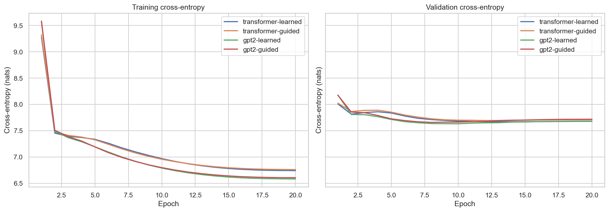

#### Expert usage (final epoch)

| Learned routing | Vocabulary-guided routing |
|---|---|
| 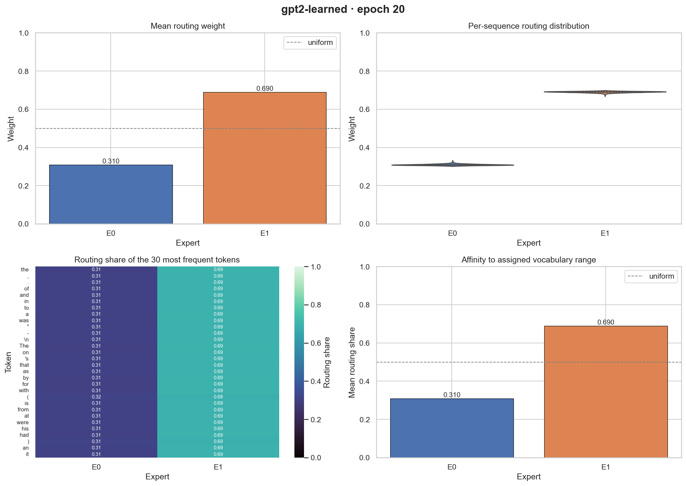 | 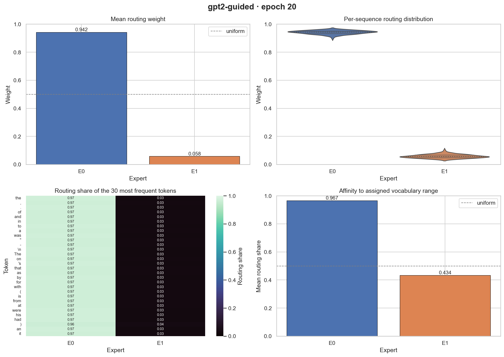 |

<details>
<summary>Transformer experts</summary>

| Learned routing | Vocabulary-guided routing |
|---|---|
| 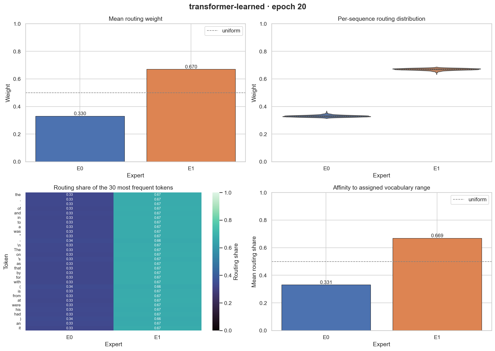 |  |

</details>

#### Samples side by side

All four models continue the same prompts with the same seed at temperature 0.7, using their best checkpoints. The
output is truncated to 40 words.

**The history of artificial intelligence** …

| Model | Continuation (T = 0.7) |
|---|---|
| `transformer-learned` | in the left he in the sympath 2 is Command of the United NR. Theias'sout, the first, The second, onbs, that but a they. Thes. The circular offer. He above the the pe to the they |
| `transformer-guided` | in the dissatisfied for he through Wy the National, body and theA), but, the best an Institute, a first the candidateA-During the We the second a The 50 in the 2005, hold the 1. The north. Speaking |
| `gpt2-learned` | of ab In a producer cut), on the A, the Bush of the 1. The Cold operations to a next for the second proposed. The team, but a entrance as first had, company was has also ( performed, in the |
| `gpt2-guided` | a season, and the season and " the the theIn the000 also directed by the Arkansas two the successful, and ( services to the 2014 as they, but end. In the the time. In " the last. The first Two … |

**In recent scientific discoveries,** …

| Model | Continuation (T = 0.7) |
|---|---|
| `transformer-learned` | " it of the little and finally of a Marian with it for the next, the legs with a continued for the album later, which of the British, " it is been. The two.ado, he, the Cides to the unrest |
| `transformer-guided` | to album, the be written. The they it. The been more,g. The only, in the 16 and in theark in the Football a Ancient to the witness, and a 0 that the British the first as it in the first |
| `gpt2-learned` | the leading, but his return, the University to the Polish Lawson thene that the soundtrack, and his,. He of the British-class that on the wolf of a woman which, Jordan for the war, " the novel ( appointed Jefferson and |
| `gpt2-guided` | a Board. In the type of the first had an company was has the Little performed, in the same the both the standby of the Institute of the the primary, in the wolf who cave as the gunout of a … |

**The most important aspect of learning is** …

| Model | Continuation (T = 0.7) |
|---|---|
| `transformer-learned` | to the particular. Theic species of the team of acut with thedollar of the fans to the needle are circulated on the fleet at most by the Drew. The of thebled the shell on the main thec is been was … |
| `transformer-guided` | funeral it. maxim. The an basis. The second if the first theirgrown; beent for the be the British all in a most and team no the Bulls released in the day and the Royal. In the British major the United … |
| `gpt2-learned` | a Townsend record for the supply the different 47 of the described. In the however, K exception. During the last and the Tree by the British the Girls, the remainder- hardness of the first, and Allram to the sem of … |
| `gpt2-guided` | a Institute in the mask for which a Jordan for the their President of the novel ( butat and the assassins, the ", the milk were altered. The a my German, video the novel, and thed as when and the … |

<details>
<summary>More prompts</summary>

**The future of technology lies in** …

| Model | Continuation (T = 0.7) |
|---|---|
| `transformer-learned` | the triple time of theit to the surrender, and andh jointly with 33. Each and the main the UK in the Hockey- got, and number- ship of the Polish. He the result with a significance of which to the album's … |
| `transformer-guided` | the panel of the 2006. The last and the the time, and 6. The Roman was the own the research,000 the Nations that a the be deep with the " declined- specific. The increased, the early during the a name |
| `gpt2-learned` | a press in the G. It Iire to be later of the United6, the Blue the British the John, a long " in the Globe and control) played- ore the tax in a time and the first is known ". … |
| `gpt2-guided` | the Girls, the remainder- hardness, which the the first All that the chapel sem of Lincoln the early off were throughout the the area, and aury and theA for the top of " a 1954 with the British the� of … |

**The great poet of Persia, Jallaludin Rumi once said, if the world brings you to your knees, you are in the** …

| Model | Continuation (T = 0.7) |
|---|---|
| `transformer-learned` | species to sexual trade- Egyptians, stone in the aid, in the use of the Stanton. The first Fey and a caves 7 of the information and the representatives on the us the reserve of theinf went on the season version … |
| `transformer-guided` | first a new not chamber-In the Germans in he, from the heavy. The Lo, and the first. In the government of the British 28 of or Polish historyc. The three and a song " the number, the anand |
| `gpt2-learned` | mainyear-� the city in the outbreak of Sam secondologies the U in the project, he for the Goat. The first game. Jackets and and an and the new called the 24 of the final Lynn and theinf of the real … |
| `gpt2-guided` | four control) andox, the tax in a lack and the first is known "., the water of the a as the week- moral in an and the his a target to a targeting as dwell and the including fictional. In … |

</details>

Regenerate an experiment's material with `python report.py runs/<transformer_run> runs/<gpt2_run> --out docs/<experiment>`. It writes the
figures and `results.md` into that folder.

## Extending

The interfaces in [models/base.py](models/base.py) are the extension points:

- **New expert architecture:** subclass `Expert` (causal map `[B,T,D] → [B,T,D]`) in
  [models/experts.py](models/experts.py), then register it in `EXPERTS` in [models/\_\_init\_\_.py](models/__init__.py).
- **New routing strategy:** subclass `Router` and return `Routing(weights [B,T,E], {name: weighted_loss})`, then
  register it in `ROUTERS`.

Both appear in the `train.py` CLI choices automatically, and loss columns in the log table follow the router's loss
names.

## Roadmap

1. **Token-level router:** route on the current token's hidden state (optionally plus the prefix mean) instead of
   the prefix mean alone, so guidance and learned routing can actually differ per token (Experiment 2, finding 5).
2. **Training efficiency:** mixed precision (bf16), `torch.compile`, no weight decay on embeddings/norms, LR warm-up.
3. **Sparse token-level MoE:** shared causal attention with top-k expert FFNs (Switch/Mixtral style), capacity
   factor, Switch load-balance loss and router z-loss.
4. **More guidance signals:** word-start vs. sub-word, part-of-speech classes, or random hashing (frequency bands are done).
5. **Fair baselines and seeds:** a dense model with matched active parameters, and wider `HIDDEN_DIM` sweeps.

## Changelog

**2026-10-16: experiment 2**

- Added the `freq` routing strategy: frequency bands carrying equal token mass, stored in the checkpoint.
  `PartitionGuidedRouter` replaces `VocabGuidedRouter`.
- Added early stopping (`PATIENCE`). Each model's best checkpoint is now plotted and its usage and affinity are
  saved in `results.json`. `report.py --out` writes each experiment's material to its own folder.
- New defaults: `HIDDEN_DIM` 64, `NUM_HEADS` 4, full training split, `STRIDE` 64, `EPOCHS` 10.

**2026-10-16: first results**

- All four models were trained with the fixed code. The [Results](#results) section covers metrics, curves, expert
  usage and side-by-side samples.
- Added `report.py`, which builds `docs/` from run folders.
- The default budget is now `EPOCHS` = 20 and `STRIDE` = 32, which completes all four models in about an hour on an
  idle GPU.

**2026-10-15: data pipeline**

- Articles are now one EOS-separated token stream. Before, paragraphs shorter than 128 tokens and every
  paragraph's leftover tail were dropped.
- Validation and test use non-overlapping windows over the full splits.
- WikiText detokenization replaces BeautifulSoup, which had no HTML to process, and `beautifulsoup4` is no longer a
  dependency.
- Tokenized splits are cached, the fast GPT-2 tokenizer is used, and the dataset is one tensor read through window
  views.

**2026-10-15: correctness overhaul and restructure**

- *Guided routing was inactive:* token assignments were computed from embeddings instead of token ids, so the
  routing loss was always 0 and the mixing weights summed to 0.6.
- *The Transformer expert attended across the batch:* `nn.MultiheadAttention` defaulted to `batch_first=False`, and
  there was no causal mask. Both are fixed.
- *The router saw future tokens:* it used a whole-sequence mean. It now uses a causal prefix mean, so routing is per
  position.
- The plots now use the model's own routing path. Before, they used different positional encodings and no
  temperature.
- The route temperature is a fixed buffer. Before, it was learnable and weight decay pulled it toward 0.
- The device is passed explicitly. The best checkpoint is reloaded before testing and generation, and the test split
  is now evaluated.
- Four near-identical model classes were replaced by `Expert` / `Router` interfaces, a registry and one
  `MixtureOfExpertsLM`.
- Added resumable checkpoints, per-run folders, table logging, best-checkpoint previews, `infer.py`, launch configs
  and `requirements.txt`.
