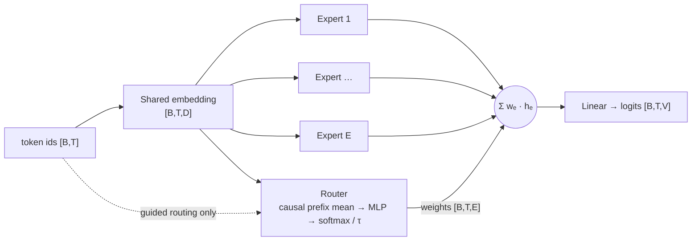

# moe-gpt2

A small research playground for **Mixture-of-Experts language models** trained on WikiText-2 with the GPT-2 tokenizer.
It compares two **expert architectures** (a hand-written causal Transformer and a Hugging Face GPT-2 stack) under two
**routing strategies** (a learned router and a vocabulary-guided router), with resumable training, structured logs and
expert-usage plots.

> **Status (2026-10-15):** the code was overhauled. Earlier results came from versions with routing and attention
> bugs (see [Changelog](#changelog)) and have been discarded. The results tables are filled in after the first full
> run with the fixed code.

---

## Contents

- [Architecture](#architecture)
- [Data](#data)
- [Routing strategies](#routing-strategies)
- [Losses](#losses)
- [Project layout](#project-layout)
- [Setup](#setup)
- [Usage](#usage)
- [Configuration](#configuration)
- [Outputs and logs](#outputs-and-logs)
- [Results](#results)
- [Extending](#extending)
- [Roadmap](#roadmap)
- [Changelog](#changelog)

---

## Architecture

Every model is a `MixtureOfExpertsLM`. It has a shared token embedding and *E* experts that each process the full
sequence. A router mixes the experts **per position**, and a linear head produces vocabulary logits.



| Expert | Implementation | Positions | Attention |
|---|---|---|---|
| `transformer` | `NUM_LAYERS` post-LN blocks built on `nn.MultiheadAttention` | learned, per expert | causal mask |
| `gpt2` | Hugging Face `GPT2Model` fed with `inputs_embeds` | GPT-2 `wpe`, per expert | causal (built in) |

**Causality.** Every component only sees tokens at or before the current position. Attention is masked, and the
router works on a *running* (prefix) mean of the embeddings, so training and generation behave the same way.

## Data

WikiText-2 (raw), tokenized with the GPT-2 BPE tokenizer.

1. **Clean:** WikiText's tokenized spacing is undone: `role @-@ playing` becomes `role-playing`, `1 @,@ 000`
   becomes `1,000`, and `game 's` becomes `game's`. The spaces before punctuation are removed, and section headers
   are dropped.
2. **Stream:** each article's paragraphs are joined with newlines, and every article ends with an EOS token. Each
   split becomes one token stream, so nothing is thrown away.
3. **Window:** training uses 128-token windows every `STRIDE` tokens. Validation and test use stride 127, so every
   token is predicted exactly once.
4. **Cache:** the tokenized splits are saved to `cache/`. After the first run, loading takes about 0.1 s.

| Split | Tokens | Articles | Windows (default config) |
|---|---|---|---|
| train | 2,248,681 | 629 | 28,093 (first 10%, stride 8) |
| validation | 232,423 | 60 | 1,830 |
| test | 266,053 | 62 | 2,094 |

`DATA_FRACTION` only shrinks the training stream. Validation and test always use the full split, so metrics are
comparable between runs.

## Routing strategies

| Strategy | Class | Mixing weights | Auxiliary loss |
|---|---|---|---|
| `learned` | `LearnedRouter` | `softmax(MLP(prefix_mean) / τ)`, τ = 2.0 | **balance**: MSE between mean expert usage and uniform |
| `guided` | `VocabGuidedRouter` | `0.6 · learned + 0.4 · onehot(expert assigned to the current token)`, τ = 1.2 | **routing**: NLL of the assigned expert under the learned router |

The guided router splits the vocabulary into *E* contiguous id ranges and gives each range to one expert, in the
spirit of *Hash Layers* (Roller et al., 2021). The plots report each expert's **affinity**: its average routing share
on the tokens assigned to it. This number is comparable across both strategies, so it shows whether guidance
actually changes routing.

## Losses

```
total = TASK_LOSS_WEIGHT · cross_entropy  +  diversity  +  (balance | routing)
```

| Term | Weight (`config.py`) | Purpose |
|---|---|---|
| Cross-entropy | `TASK_LOSS_WEIGHT` = 0.8 | next-token prediction (reported unweighted as `train ce` / `val ce`) |
| Diversity | `DIVERSITY_LOSS_WEIGHT` = 0.1 | mean \|cosine similarity\| between expert outputs, to keep experts different |
| Balance | `BALANCE_LOSS_WEIGHT` = 0.1 | learned router: avoid collapsing onto one expert |
| Routing | `ROUTING_LOSS_WEIGHT` = 0.1 | guided router: agree with the vocabulary partition |

## Project layout

```
moe-gpt2/
├── train.py            CLI: train → test → sample, for one architecture and its routing strategies
├── infer.py            CLI: generate text from a trained run (single prompt or interactive)
├── config.py           every hyper-parameter in one place
├── data.py             WikiText-2 cleaning, token stream, cache and windowed DataLoaders
├── trainer.py          training loop, evaluation, resumable checkpoints, seeding
├── generation.py       sampling, best-checkpoint previews and end-of-training samples
├── plotting.py         expert-usage figure (utilisation, distribution, token heatmap, affinity)
├── log_utils.py        console + file logger, banners and aligned tables
├── models/
│   ├── __init__.py     registries (EXPERTS, ROUTERS) and build_model()
│   ├── base.py         interfaces: Expert, Router, Routing
│   ├── experts.py      TransformerExpert, GPT2Expert
│   ├── routers.py      LearnedRouter, VocabGuidedRouter
│   └── moe.py          MixtureOfExpertsLM and the diversity loss
├── .vscode/launch.json run, resume and inference configurations
└── requirements.txt
```

## Setup

Tested with Python 3.10, PyTorch 2.5.1 and CUDA 11.8 in the `gpt2` conda env.

```bash
conda activate gpt2                       # C:\Users\Precision\anaconda3\envs\gpt2
pip install -r requirements.txt --extra-index-url https://download.pytorch.org/whl/cu118
```

WikiText-2 and the GPT-2 tokenizer are downloaded by Hugging Face on first use. Tokenized splits are cached in `cache/`.

## Usage

### Train

```bash
python train.py --arch transformer                   # both routing strategies, one after the other
python train.py --arch gpt2 --routing guided         # a single strategy
```

### Resume

Each epoch writes a full checkpoint containing the model, optimizer, RNG states and history. An interrupted run
continues where it stopped. A model that already finished is reloaded and tested, but not retrained.

```bash
python train.py --arch transformer --resume latest                         # newest transformer run
python train.py --arch gpt2 --resume runs/gpt2_20261015_120000             # a specific run
```

The learning-rate schedule is a closed-form cosine, so resuming with a different `EPOCHS` stays on schedule. Any
setting that changed since the run started is logged as a warning.

### Inference

```bash
python infer.py --prompt "The history of artificial intelligence"           # newest run, first model
python infer.py --run runs/gpt2_20261015_120000 --model gpt2-guided         # interactive prompt loop
python infer.py --prompt "In recent scientific discoveries," --temperature 1.0 --max-new-tokens 80
```

`infer.py` restores the run's saved `settings.json` before it builds the model, so a checkpoint still loads after
`config.py` has changed.

### VS Code

`.vscode/launch.json` provides **Train**, **Resume** (prompts for a run folder; default `latest`) and
**Inference · interactive** (pick the run and model), all using the `gpt2` env interpreter.

## Configuration

All settings live in [config.py](config.py) and are saved with every run.

| Group | Setting | Default |
|---|---|---|
| Data | `CONTEXT_LENGTH`, `STRIDE` (train), `DATA_FRACTION` (train), `DATA_CACHE_DIR` | 128, 8, 0.1, `cache` |
| Model | `NUM_EXPERTS`, `HIDDEN_DIM`, `NUM_HEADS`, `NUM_LAYERS`, `DROPOUT` | 2, 8, 2, 2, 0.3 |
| Routing | `LEARNED_ROUTE_TEMPERATURE`, `GUIDED_ROUTE_TEMPERATURE`, `GUIDED_LEARNED_SHARE` | 2.0, 1.2, 0.6 |
| Training | `EPOCHS`, `BATCH_SIZE`, `LEARNING_RATE`, `WEIGHT_DECAY`, `GRAD_CLIP` | 100, 16, 6e-4, 0.01, 0.5 |
| Output | `PLOT_EVERY`, `RUNS_DIR`, `SEED` | 5, `runs`, 42 |

## Outputs and logs

Each run gets its own folder:

```
runs/transformer_20261015_120000/
├── train.log                         full console log (appended on resume)
├── settings.json                     CLI arguments + config values
├── results.json                      final comparison table
├── transformer-learned.pth           best weights (by validation CE)
├── transformer-learned_last.pth      resumable checkpoint
├── transformer-learned_history.json  per-epoch metrics
├── transformer-learned_samples.json  end-of-training samples {prompt: {temperature: text}}
└── plots/
    ├── training_curves.png           train/val CE of every model in the run
    └── transformer-learned_epoch001.png …
```

Logs are tables, one row per epoch. ★ marks a new best checkpoint, and a short sample is printed after it:

```
20:21:16 │   epoch │       lr │ train ce │ diversity │   routing │  val ce │   val ppl │     usage │  affinity │   tok/s │  time │
20:21:16 │ ────────┼──────────┼──────────┼───────────┼───────────┼─────────┼───────────┼───────────┼───────────┼─────────┼───────┼──
20:21:16 │     1/1 │ 6.00e-04 │  10.9987 │    0.0887 │    0.0808 │ 10.9861 │   59049.5 │ 0.64/0.36 │ 0.67/0.73 │    2.4k │   19s │ ★
20:21:16 │     ✎ The history of artificial intelligence ⟶ …
```

*(Shown in format only: a smoke test on 3% of the data for one epoch. The first epoch includes CUDA and DataLoader
worker start-up.)*

Each plot has four panels: mean routing weight per expert, the per-sequence routing distribution, the routing share
of the 30 most frequent tokens, and the affinity to each expert's assigned vocabulary range.

## Results

> Pending the first full run with the fixed code. This section will gain the comparison table, training curves, an
> expert-usage figure and sample generations.

| Model | Params | Best val CE | Test CE | Test PPL | Minutes |
|---|---|---|---|---|---|
| transformer-learned | 859,995 | – | – | – | – |
| transformer-guided | 859,995 | – | – | – | – |
| gpt2-learned | 860,043 | – | – | – | – |
| gpt2-guided | 860,043 | – | – | – | – |

## Extending

The interfaces in [models/base.py](models/base.py) are the extension points:

- **New expert architecture:** subclass `Expert` (causal map `[B,T,D] → [B,T,D]`) in
  [models/experts.py](models/experts.py), then register it in `EXPERTS` in [models/\_\_init\_\_.py](models/__init__.py).
- **New routing strategy:** subclass `Router` and return `Routing(weights [B,T,E], {name: weighted_loss})`, then
  register it in `ROUTERS`.

Both appear in the `train.py` CLI choices automatically, and loss columns in the log table follow the router's loss
names.

## Roadmap

1. **Training efficiency:** mixed precision (bf16), `torch.compile`, no weight decay on embeddings/norms, LR warm-up.
2. **Sparse token-level MoE:** shared causal attention with top-k expert FFNs (Switch/Mixtral style), capacity
   factor, Switch load-balance loss and router z-loss.
3. **Better guidance signals:** token-frequency buckets, word-start vs. sub-word, or hashing in place of id ranges.
4. **Fair baselines:** a dense model with matched active parameters, and wider `HIDDEN_DIM` sweeps.

## Changelog

**2026-10-15: data pipeline**

- Articles are now one EOS-separated token stream. Before, paragraphs shorter than 128 tokens and every
  paragraph's leftover tail were dropped.
- Validation and test use non-overlapping windows over the full splits.
- WikiText detokenization replaces BeautifulSoup, which had no HTML to process, and `beautifulsoup4` is no longer a
  dependency.
- Tokenized splits are cached, the fast GPT-2 tokenizer is used, and the dataset is one tensor read through window
  views.

**2026-10-15: correctness overhaul and restructure**

- *Guided routing was inactive:* token assignments were computed from embeddings instead of token ids, so the
  routing loss was always 0 and the mixing weights summed to 0.6.
- *The Transformer expert attended across the batch:* `nn.MultiheadAttention` defaulted to `batch_first=False`, and
  there was no causal mask. Both are fixed.
- *The router saw future tokens:* it used a whole-sequence mean. It now uses a causal prefix mean, so routing is per
  position.
- The plots now use the model's own routing path. Before, they used different positional encodings and no
  temperature.
- The route temperature is a fixed buffer. Before, it was learnable and weight decay pulled it toward 0.
- The device is passed explicitly. The best checkpoint is reloaded before testing and generation, and the test split
  is now evaluated.
- Four near-identical model classes were replaced by `Expert` / `Router` interfaces, a registry and one
  `MixtureOfExpertsLM`.
- Added resumable checkpoints, per-run folders, table logging, best-checkpoint previews, `infer.py`, launch configs
  and `requirements.txt`.
